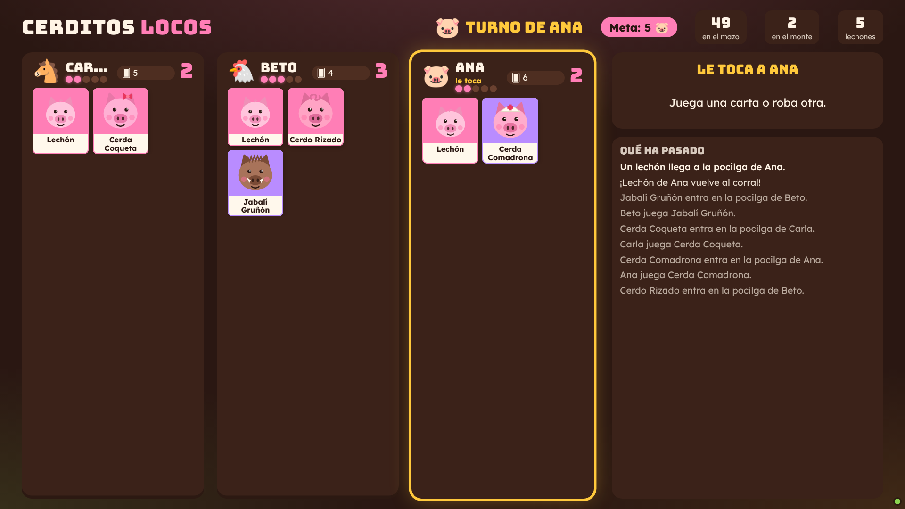
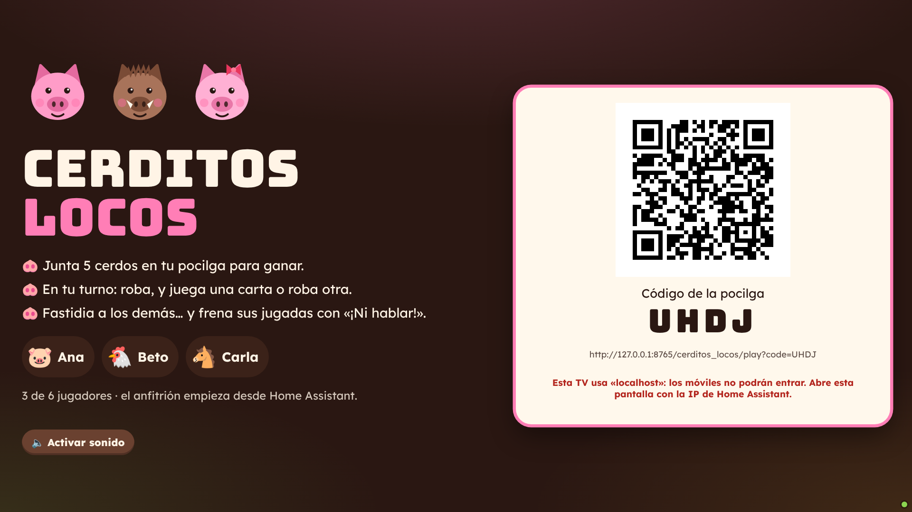
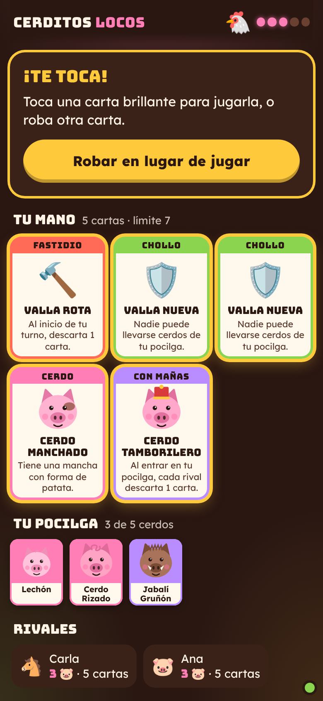
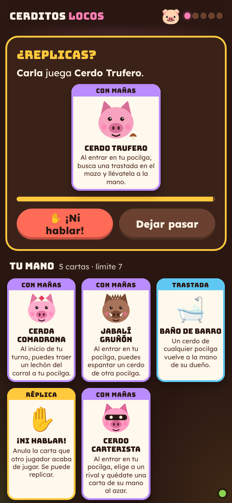
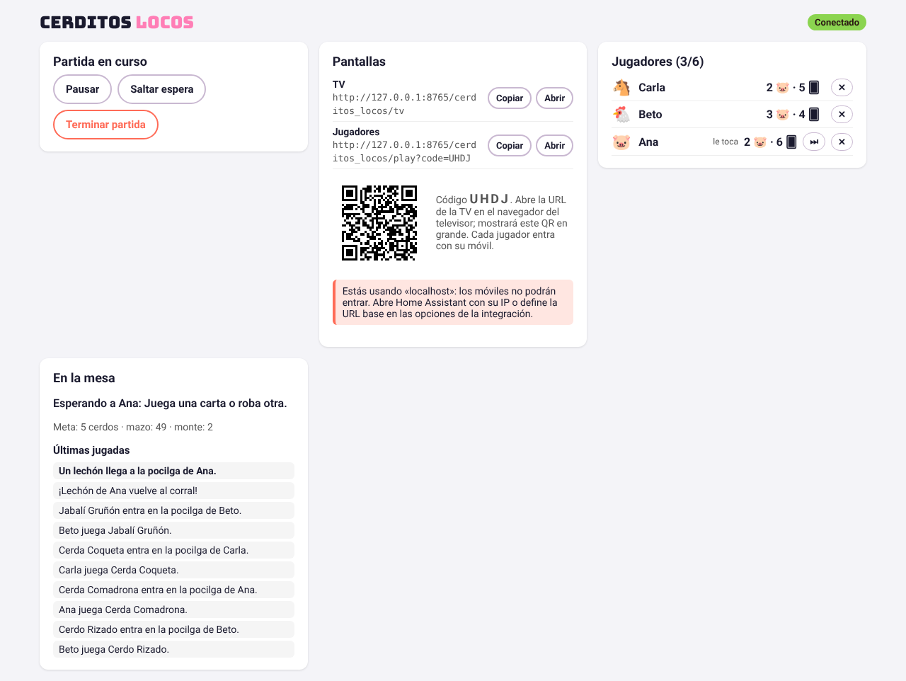

# Cerditos Locos

Juego de cartas estratégico y multijugador para **Home Assistant**. La tele muestra las pocilgas de todos, de quién es el turno y qué acaba de pasar; cada jugador lleva su mano en el navegador de su móvil, escaneando un QR. Todo funciona en tu red local, sin apps, cuentas ni servicios en la nube.



- 2 a 6 jugadores, cada uno con su móvil. Partidas de 20–35 minutos.
- Junta cerdos en tu pocilga, fastidia a los demás y frena sus jugadas con «¡Ni hablar!».
- 70 cartas originales en español: cerdos, cerdos con mañas, trastadas, chollos, fastidios y réplicas.
- Home Assistant manda: valida cada jugada, guarda las manos en secreto y comprueba la victoria.
- La partida sobrevive a un reinicio de Home Assistant: los móviles se reconectan solos.
- El anfitrión controla la partida desde un panel de Home Assistant protegido por tu login de administrador.

| TV | Móvil: tu turno | Móvil: réplica | Anfitrión |
|---|---|---|---|
|  |  |  |  |

> Cerditos Locos está inspirado en las mecánicas generales de los juegos de cartas de «construye tu establo y fastidia a los demás». Es un proyecto independiente y **no está afiliado** a Unstable Games ni a Unstable Unicorns. Nombres, textos, reglas redactadas e ilustraciones son originales.

## Requisitos

- Home Assistant **2025.1 o posterior** (OS, Container, Core o Supervised).
- Una TV con navegador moderno (Chromecast con Google TV, Fire TV con Silk, Android TV, un portátil por HDMI…).
- Un móvil por jugador, en la **misma red** que Home Assistant.
- Sin dependencias externas ni conexión a Internet.

## Instalación

### Opción A: HACS (repositorio personalizado)

1. En Home Assistant: **HACS → ⋮ → Repositorios personalizados**.
2. Pega `https://github.com/VivekMahtani/cerditos-locos` y elige la categoría **Integración**.
3. Busca **Cerditos Locos** en HACS y pulsa **Descargar**.
4. Reinicia Home Assistant.
5. **Ajustes → Dispositivos y servicios → Añadir integración → Cerditos Locos**.

### Opción B: manual

1. Copia la carpeta `custom_components/cerditos_locos/` dentro de tu carpeta de configuración de Home Assistant, para que quede:
   ```
   /config/custom_components/cerditos_locos/manifest.json
   ```
   Puedes usar *Samba share*, *File editor*, *Studio Code Server* o `scp`.
2. Reinicia Home Assistant.
3. **Ajustes → Dispositivos y servicios → Añadir integración → Cerditos Locos**.

Sabrás que ha cargado porque aparece **Cerditos Locos** en la barra lateral (solo para administradores).

## Cómo se juega

1. **Abre la TV** en `http://IP-DE-HOME-ASSISTANT:8123/cerditos_locos/tv` (por ejemplo `http://192.168.1.50:8123/cerditos_locos/tv`). Verás el QR y el código de la pocilga. No hace falta iniciar sesión en la TV.
2. **Únete con el móvil.** Escanea el QR (o abre `http://IP:8123/cerditos_locos/play` y escribe el código de 4 letras), pon tu nombre y elige avatar. Solo se puede entrar antes de empezar.
3. **Empieza.** El anfitrión abre **Cerditos Locos** en la barra lateral de Home Assistant y pulsa **Empezar partida**. Si quiere jugar, que abra también la página de jugador en su móvil.

Cada jugador empieza con un **lechón** en su pocilga y **5 cartas** en la mano.

### Tu turno

1. **Inicio:** se aplican los efectos «al inicio de tu turno» de tu pocilga.
2. **Robo:** robas 1 carta.
3. **Acción:** juegas 1 carta **o** robas otra más. En el móvil, las cartas que puedes jugar brillan; tócala, revisa qué hace y confirma.
4. **Final:** si tienes más cartas que tu límite (7), descartas.

### Gana

Quien junte en su pocilga **6 cerdos** (con 2–4 jugadores) o **5 cerdos** (con 5–6) gana al instante. Los lechones cuentan como cerdos. Si el mazo se acaba, gana quien tenga más cerdos (los empates comparten la victoria).

### Las cartas

| Tipo | Qué hace |
|---|---|
| 🐷 **Lechón** | Empieza en tu pocilga. Si sale de ella, vuelve al corral. |
| 🐷 **Cerdo** | Un cerdo más para tu pocilga. |
| 🐷 **Cerdo con mañas** | Cerdo con un efecto: al entrar, al inicio de tu turno o mientras esté en tu pocilga. |
| 💨 **Trastada** | Efecto inmediato; después va al monte (la pila de descarte). |
| 🛡️ **Chollo** | Se queda en tu pocilga y te ayuda. |
| 🦟 **Fastidio** | Se lo pones a un rival y le complica la vida. |
| ✋ **¡Ni hablar!** | Anula la carta que otro acaba de jugar. Se puede replicar. |
| 🛑 **¡Ni hablar, y punto!** | Igual, pero nadie puede replicarla. |

La lista completa está en [docs/game-design.md](docs/game-design.md#7-catálogo).

### Réplicas

Cuando alguien juega una carta, **todos los demás móviles** preguntan «¿Replicas?» durante unos segundos (8 por defecto). Todos ven la misma pregunta, tengan réplicas o no, así nadie sabe quién guarda un «¡Ni hablar!». Puedes contrarreplicar una réplica: la carta vale o queda anulada según cuántas réplicas se encadenen. La ventana se cierra en cuanto todos dejan pasar.

### Si alguien pierde la conexión

El móvil se reconecta solo y recupera su mano, aunque recargue la página. Si le toca decidir a alguien desconectado, la partida espera 30 segundos (configurable) y luego juega por él lo más prudente: robar en lugar de jugar, no usar efectos opcionales y elegir al azar lo obligatorio. El anfitrión puede **saltar** esa espera o **expulsar** al jugador (sus cartas van al monte).

### Controles del anfitrión

**Empezar**, **Pausar / Reanudar** (congela los tiempos), **Saltar espera**, **Terminar partida** (gana quien tenga más cerdos), **Nueva partida** y **Expulsar**. Las acciones irreversibles piden confirmación. Antes de empezar se puede configurar:

- **Cerdos para ganar:** automático (6, o 5 con 5–6 jugadores) o de 4 a 8.
- **Tiempo para replicar:** de 5 a 20 segundos, o sin réplicas (se retiran del mazo).
- **Espera a jugadores desconectados:** de 15 a 120 segundos.

## Opciones de la integración

**Ajustes → Dispositivos y servicios → Cerditos Locos → Configurar**:

- **Solo red local** (activado por defecto): las páginas y el WebSocket del juego rechazan conexiones desde IP públicas.
- **URL base para la TV y los móviles:** la dirección que va en el QR. Defínela (por ejemplo `http://192.168.1.50:8123`) si abres la TV con `localhost`, con un nombre que los móviles no resuelven o detrás de un proxy.

## Automatizaciones

El evento `cerditos_locos_event` se dispara con `type` igual a `player_joined`, `game_started`, `turn_started`, `card_played`, `reacted`, `card_cancelled`, `pig_scared`, `pig_stolen`, `drew_instead`, `game_finished` o `new_game`, además de `phase`, `code`, `players`, `turn` y `active`. Por ejemplo, luces de fiesta al acabar:

```yaml
automation:
  - alias: Fiesta en la pocilga
    triggers:
      - trigger: event
        event_type: cerditos_locos_event
        event_data:
          type: game_finished
    actions:
      - action: scene.turn_on
        target:
          entity_id: scene.fiesta
```

## Seguridad y privacidad

- Nada sale de tu red: sin analítica, sin CDN, sin cuentas. El QR se genera en Home Assistant.
- Cada móvil recibe solo **su** mano. La TV y los demás jugadores solo ven cuántas cartas tienes (hay una prueba automática que lo comprueba en los mensajes reales).
- Solo los administradores de Home Assistant ven el panel y obtienen el token de anfitrión. La TV y los móviles nunca reciben credenciales de Home Assistant.
- El servidor valida cada mensaje, limita su tamaño y frecuencia y bloquea intentos repetidos con códigos incorrectos.
- La partida en curso (nombres, cartas y sesiones) se guarda en `/config/.storage/cerditos_locos.partida` para sobrevivir a reinicios. Se sobrescribe con cada partida nueva y se borra al desinstalar.

## Solución de problemas

| Problema | Solución |
|---|---|
| El QR abre una página que no carga | El móvil debe estar en la misma wifi que Home Assistant (no en la de invitados). Revisa la **URL base**. |
| La TV avisa de «localhost» | Abre la TV con la IP de Home Assistant o define la URL base. |
| «La partida ya ha empezado» | Solo se entra en la sala de espera. El anfitrión puede terminar y empezar una nueva. |
| El móvil se apaga y pierde el turno | Con HTTP los navegadores no dejan mantener la pantalla encendida; súbele el tiempo de bloqueo. La partida espera y luego juega por ti. |
| No aparece el panel | Tu usuario debe ser administrador. Recarga el navegador. |
| No se oye nada en la TV | Pulsa **Activar sonido** en la sala de espera de la TV. |

## Actualizar y desinstalar

- **Actualizar con HACS:** HACS → Cerditos Locos → Actualizar, y reinicia.
- **Actualizar a mano:** sustituye `custom_components/cerditos_locos/` y reinicia. Una partida guardada de otra versión se descarta si no es compatible.
- **Desinstalar:** elimina la integración en **Ajustes → Dispositivos y servicios**, después en HACS (o borra la carpeta) y reinicia. Si quieres, borra también `/config/.storage/cerditos_locos.partida`.

## Desarrollo

```bash
python3 -m pip install pytest            # opcional: opencv-python-headless para el test del QR
python3 -m pytest                         # motor, hub, QR, red y capa HA (con dobles)

# Simulación masiva con bots: bloqueos, invariantes y equilibrio
python3 dev/simulate.py --games 10000
python3 dev/simulate.py --games 10000 --chaos   # desconexiones, tiempos agotados y expulsiones

# Servidor de desarrollo sin Home Assistant (mismo núcleo y mismo frontend)
python3 dev/devserver.py --port 8765 [--goal 4] [--save /tmp/partida.json]
#   TV:        http://IP:8765/cerditos_locos/tv
#   Jugadores: http://IP:8765/cerditos_locos/play
#   Anfitrión: http://IP:8765/dev/host   (sin autenticación: solo para desarrollo)

# Partida completa con navegadores reales (Playwright + Chrome)
python3 tests/e2e/run_e2e.py --chrome /usr/bin/google-chrome
```

Documentación técnica: [reglas y diseño](docs/game-design.md), [arquitectura](docs/architecture.md) y [plan de pruebas](docs/test-plan.md).

## Licencia

- **Código:** MIT (ver `LICENSE`). Partes de la infraestructura proceden de [Quiz del Salón](https://github.com/VivekMahtani/quiz-salon), del mismo autor y con la misma licencia.
- **Cartas** (nombres, textos e ilustraciones SVG generadas por código): CC BY-SA 4.0.
- **Tipografías:** [Bungee](https://github.com/djrrb/Bungee) y [Lexend](https://github.com/googlefonts/lexend), SIL Open Font License 1.1 (textos en `custom_components/cerditos_locos/frontend/fonts/`).

«Cerditos Locos» es un proyecto independiente, no oficial y sin relación con Unstable Games. Antes de cualquier uso comercial conviene hacer una búsqueda de marcas sobre el nombre y una revisión legal profesional.
